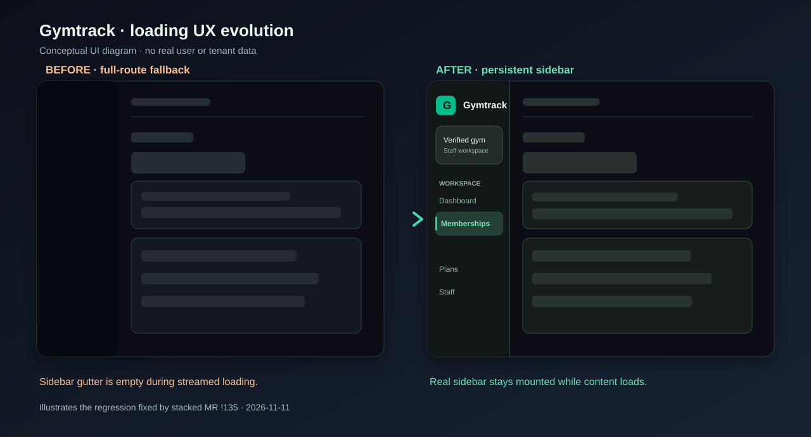
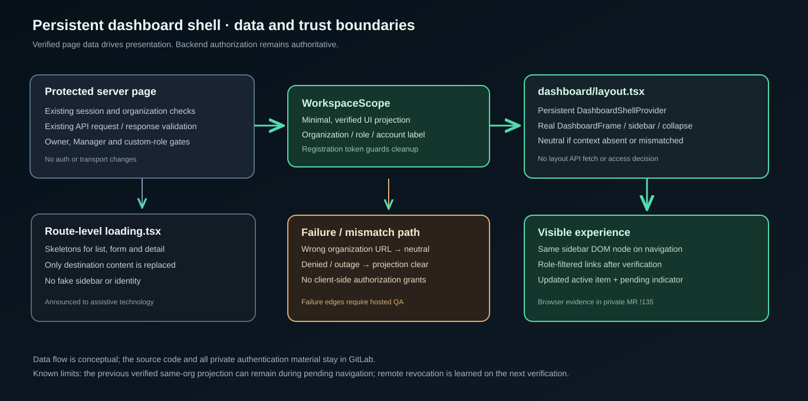
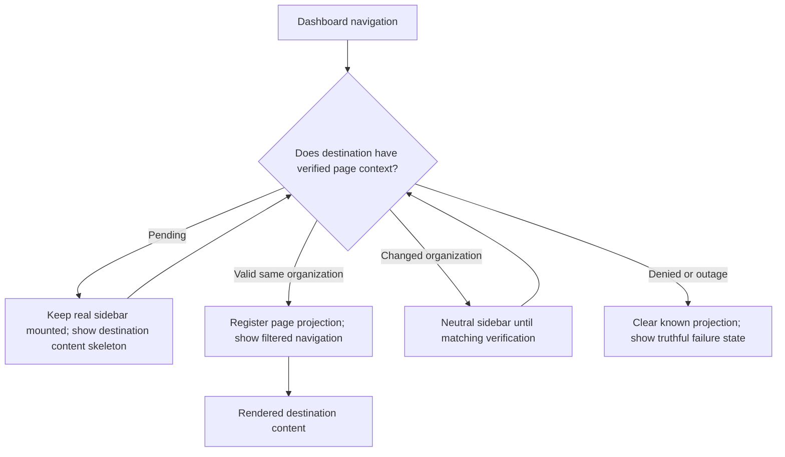

# Gymtrack frontend UI unification — delivery record and handoff

**As of:** 2026-11-11  
**System:** Gymtrack, a multi-tenant gym-management SaaS  
**Integration branch:** `develop`  
**Integrated merge SHA:** `d7882f590230a1dd6c6be9c63f8aec5e96049401`  
**Classification:** Public-safe engineering summary. This is not a production certification.

> **Outcome:** The redesigned dashboard, all operational routes, identity/recovery screens, admin experience and public UI are integrated into `develop`. The loading experience now uses contextual skeletons while a single verified dashboard sidebar persists across tested navigation. Protected-branch CI and both Vercel checks succeeded. Hosted acceptance and outstanding security-transition cases remain separate.

## 1. Release status and source-of-truth hierarchy

| Layer | Verified or recorded state | Boundary |
|---|---|---|
| Merged code | [MR !135](https://gitlab.com/trackgym101/gymsas/-/merge_requests/135) merged into [MR !134](https://gitlab.com/trackgym101/gymsas/-/merge_requests/134); then !134 merged into `develop` on 2026-11-11 | GitLab confirms merge commits |
| Final `develop` | `d7882f590230a1dd6c6be9c63f8aec5e96049401` | GitLab branch read |
| Code scope | 76 changed paths in !134's final diff, all inside `apps/web/src/app/**`; !135 contributes 11 paths already included in that final diff | Source diff, not a claim about every runtime behavior |
| UI route coverage | 35 page routes accounted for: 33 visual routes and two redirect-only routes | Agent-reported route ledger, reconciled with GitLab |
| Post-merge CircleCI | [Protected-branch workflow](https://app.circleci.com/workflow/913b9701-90f0-4a3d-b7f7-a972991c054e) succeeded on exact final merge SHA | Workflow status, not authenticated hosted acceptance |
| Vercel | Web and API checks succeeded on final `develop` SHA | Build/deployment checks; no claim of production promotion |
| Local browser QA | 178 agent-recorded UI assertions across the redesign; 16 agent-recorded shell assertions on the stacked MR | Supplied test receipts; not independently rerun for this Atlas record |
| Unit/build | Agent reported ESLint, web typecheck, 756/756 web tests and build PASS | Exact merged CI status is the independently checked gate |
| Production | No separate promotion or owner-certified production acceptance is established by this record | Follow-up required |

**Authority:** GitLab is authoritative for files, MRs and merge SHAs; CircleCI and Vercel own their check statuses; runtime QA receipts and screenshot evidence live in private MR discussions. Atlas stores the engineering context and release boundary, not the proprietary source code.

## 2. Why this release was necessary

Before !134, a new dark dashboard coexisted with older standalone pages. Creating a member from the updated list navigated to a disconnected full-page form. Memberships, Plans, Staff and Roles had inconsistent page chrome. Later, the first loading pass introduced better skeletons but exposed an empty 248px gutter where the real sidebar belonged.

The work shipped in three connected steps:

1. **Design-system rollout (!134).** Adapt all routed experiences to the approved charcoal-and-emerald visual language. Preserve business actions, API transport and authorization.
2. **Loading UX rollout (!134).** Add contextual list, form and detail placeholders; improve inline Suspense and per-link pending feedback; keep actual failures distinct from loading.
3. **Persistent shell (!135, stacked into !134).** Move the real dashboard sidebar into the shared dashboard layout and feed it a minimal projection from already-verified pages. Prevent a route loader from replacing the sidebar.

This sequence matters. The skeleton update improved appearance but did not solve sidebar continuity. The stacked layout fix addresses the architectural cause.

## 3. Visual before and after

**Original vector illustration, not a captured application screenshot.** During a route fallback, the old implementation rendered an empty gutter. The final design retains the real sidebar and replaces only the content on the right.

The authorized source screenshots remain with the [frontend redesign evidence](https://gitlab.com/trackgym101/gymsas/-/merge_requests/134) and [persistent shell evidence](https://gitlab.com/trackgym101/gymsas/-/merge_requests/135). They were **not** copied into this public repository because those files can include test identities or private organization details.

### Visual system

| Element | Integrated convention |
|---|---|
| Palette | Dark charcoal backgrounds, restrained emerald navigation and actions |
| Desktop sidebar | 248px expanded; 76px collapsed |
| Desktop breadcrumb band | Approximately 72px, aligned with main content |
| Content column | Left-aligned; max-width 90rem, responsive padding |
| Mobile | Compact header and drawer, no duplicate desktop navigation |
| Feedback | Route-specific card/list/form skeletons; subtle 6px link-pending indicator after 100ms |
| Accessibility | Semantic landmarks, focus-visible states, loading status, aria-busy and reduced-motion handling |
| Content discipline | No placeholder tenant metrics, fake links, or speculative authorization data |

These are the approved design directions and code-level behaviors. Full visual acceptance across every deployed route is still subject to hosted QA.

## 4. Route coverage (35 total)

**Status vocabulary:** “UI integrated” means the route received the redesign or compatible styling. It does **not** mean every negative, mobile or hosted scenario passed. “Redirect preserved” means intentionally no visual page.

| # | Area | Route | Delivered experience | Status |
|---:|---|---|---|---|
| 1 | Dashboard | `/dashboard` | Redesigned landing, sidebar, quick actions and verified context | UI integrated |
| 2 | Members | `/dashboard/members` | Filterable list, capability-aware Add | UI integrated |
| 3 | Members | `/dashboard/members/new` | Restyled direct URL; primary Add action uses dialog | UI integrated |
| 4 | Members | `/dashboard/members/[memberId]` | Detail, related memberships and contextual loading | UI integrated |
| 5 | Members | `/dashboard/members/[memberId]/edit` | Edit with original permission and mutation behavior | UI integrated |
| 6 | Memberships | `/dashboard/memberships` | Filters, member search, list and content skeletons | UI integrated |
| 7 | Memberships | `/dashboard/memberships/new` | Create, member/plan lookup and prefill unchanged | UI integrated |
| 8 | Memberships | `/dashboard/memberships/[membershipId]` | Details, relation-denial rules and loading | UI integrated |
| 9 | Memberships | `/dashboard/memberships/[membershipId]/edit` | Edit, agreement locking and loading | UI integrated |
| 10 | Plans | `/dashboard/plans` | List, filters and owner-only writes | UI integrated |
| 11 | Plans | `/dashboard/plans/new` | Create form with unchanged price/duration mapping | UI integrated |
| 12 | Plans | `/dashboard/plans/[planId]` | Plan details | UI integrated |
| 13 | Plans | `/dashboard/plans/[planId]/edit` | Plan edit | UI integrated |
| 14 | Staff | `/dashboard/staff` | Staff directory | UI integrated |
| 15 | Staff | `/dashboard/staff/[staffMembershipId]` | Staff account, reassignment and deactivation flows | UI integrated |
| 16 | Roles | `/dashboard/roles` | Owner-only role listing | UI integrated |
| 17 | Roles | `/dashboard/roles/new` | Role creation | UI integrated |
| 18 | Roles | `/dashboard/roles/[roleId]` | Role detail and edit | UI integrated |
| 19 | Organization | `/select-organization` | Organization chooser | UI integrated |
| 20 | Recovery | `/no-access` | Access-denied recovery | UI integrated |
| 21 | Recovery | `/no-sites` | Zero-site recovery | UI integrated |
| 22 | Onboarding | `/onboarding/first-site` | First-site setup | UI integrated |
| 23 | Identity | `/login` | Credential UI | UI integrated |
| 24 | Identity | `/start` | First-login router | UI integrated |
| 25 | Identity | `/invite` | Invitation resolver | UI integrated |
| 26 | Identity | `/invite/account` | Invitation account setup | UI integrated |
| 27 | Admin | `/admin/organizations` | Organization directory | UI integrated |
| 28 | Admin | `/admin/organizations/new` | Organization creation | UI integrated |
| 29 | Admin | `/admin/organizations/[organizationId]` | Organization detail | UI integrated |
| 30 | Admin | `/admin/applications` | Application review queue | UI integrated |
| 31 | Admin | `/admin/applications/[applicationId]` | Approval / rejection / retry / reissue flows | UI integrated |
| 32 | Public | `/` | Landing page visual styling | UI integrated |
| 33 | Public | `/book-demo` | French public inquiry form | UI integrated |
| 34 | Redirect | `/admin` | Redirect only, no visual redesign | Redirect preserved |
| 35 | Redirect | `/signup` | Redirect only, no visual redesign | Redirect preserved |

**Totals:** 33 integrated visual routes and 2 intentionally unchanged redirects. The final !134 diff contains 76 changed web app files, including shared components, form presentation, CSS and loading files, not 76 route pages.

## 5. Journey-by-journey delivery

### Dashboard and shared navigation

- The landing page uses the new sidebar, breadcrumb line, quick-access destinations and organization/site/role/lifecycle cards.
- Navigation highlights the current operational section. Owner-only links remain filtered by the verified page projection.
- The sidebar can collapse on desktop and becomes a drawer on mobile. The shared shell holds this state across the tested dashboard transitions.
- The org-switch and logout affordances are preserved. Neither grants access; server checks remain authoritative.

### Members

- The Members directory received unified chrome, filters, pagination and capability-aware actions.
- **Add member opens a Radix dialog** with the existing `MemberForm`, `createMemberAction`, fields, validation and POST payload.
- Escape, Cancel, focus return, failure persistence and the original success redirect were exercised in the agent's browser fixtures.
- The original `/dashboard/members/new` route remains as a secured, styled direct-navigation fallback.
- Detail and edit use the same workspace design without changing read, update, permission or redirect rules.

### Memberships

- Directory, create, detail and edit use the new workspace chrome and contextual loading geometry.
- Existing member/plan lookups, prefilled-member branch, relation-denial paths, pagination, effective status and agreement locks were retained.
- The existing 100-item lookup limits and `include=relations` behavior were intentionally not expanded.
- Financial/date semantics and write/reconciliation behavior remain in the owning application code.

### Plans

- Lists, filters, create, detail and edit received unified presentation.
- `isActive` mappings, price/duration handling, paging and Owner-only writes were preserved.
- Membership and Plan date handling remain separate.

### Staff and Roles

- Staff list/detail, staff action forms and role management screens were restyled.
- Staff provisioning idempotency, uncertain outcomes, reassignment and deactivation flows remain governed by their original actions and checks.
- Owner-only role creation/editing, permission catalog availability and stored-versus-effective permission wording remain intact.

### Identity, recovery and onboarding

- Organization selection, no-access/no-sites recovery and first-site onboarding received dark, consistent frames.
- Login, start/first-login, invitation and account setup were styled without changing Supabase authentication or token-handling paths.
- The public signup URL remains a redirect rather than reopening public registration.
- Denial, outage and incomplete provisioning are separate states, not generic “loading.”

### Administration and public pages

- Admin organization directory/create/detail and application queue/detail use the admin-specific dark design and existing AdminShell.
- Approval, rejection, retry and credential reissue use their original confirmation and idempotency rules.
- Admin layout permissions remain separate from staff dashboard navigation.
- Public landing and the French `/book-demo` experience received styling only; field, consent, submission and content semantics were retained.

## 6. Persistent-shell architecture

The implementation added:

| File | Responsibility |
|---|---|
| `apps/web/src/app/dashboard/layout.tsx` | Wraps dashboard descendants in one persistent shell |
| `dashboard/_components/dashboard-shell.tsx` | Holds the client sidebar projection and registration lifecycle |
| `dashboard/_components/dashboard-frame.tsx` | Renders the real sidebar, collapse and mobile drawer |
| `dashboard/_components/workspace-shell.tsx` | Registers a successful page's already-verified projection; renders breadcrumb/content only |
| `dashboard/_components/loading-skeletons.tsx` | Content-only loading placeholders; no fake gutter or extra navigation |
| `dashboard/**/loading.tsx` | Destination-specific loading geometry for list, create, detail and edit routes |

Paths shortened to `apps/web/src/app/` unless otherwise stated.

### Trust model

1. Each page performs its existing server-side session, organization and capability checks.
2. The successful page passes a minimal, serializable navigation projection via `WorkspaceScope`.
3. The client layout displays verified organization and role information only when its projection matches the selected organization context.
4. A different organization in `?organization=` rejects the existing projection and shows a neutral sidebar until the destination verifies.
5. Known denied/outage states clear the projection. The layout itself does not fetch `/v1/me/context` or decide API authorization.
6. Route-level `loading.tsx` swaps the content column but not the shared layout or its sidebar DOM node.

**Why not put `getMeContext()` in the layout?** Next.js layouts persist on client transitions and do not rerender for each query-string change. A layout-owned server snapshot would become stale after organization switching. The page-fed projection avoids another API fetch solely to populate the sidebar.

The design was intentionally split into [MR !135](https://gitlab.com/trackgym101/gymsas/-/merge_requests/135), then stacked into [MR !134](https://gitlab.com/trackgym101/gymsas/-/merge_requests/134), so the authorization-adjacent rendering change could be validated separately.

### Loading/navigation state diagram

This is a model of the intended UX, not a substitute for an authorization test. Server-side access checks must deny any forbidden request regardless of visible sidebar links.

## 7. Loading UX and accessibility

The legacy centered “Loading roles” and “Please wait…” screens were replaced by contextual skeletons. Roles, Plans and Memberships have list, form and detail variants so a create route does not briefly show a directory-shaped placeholder.

Two inline Suspense states were improved: membership rows within Member detail, and member search within Memberships. Admin application queue and detail loaders remain inside their authorized Admin frame.

One page-region loading announcement, `aria-busy`, decorative `aria-hidden` shapes and reduced-motion rules avoid treating the skeleton as usable form controls. `useLinkStatus` gives the sidebar a delayed decorative pending dot without altering the link destination or accessible name.

Agent-reported DOM and browser evidence showed the *same* desktop `aside` node survived a two-second delayed Members → Roles navigation. That directly tests the original missing-sidebar bug. A cold Memberships load rendered a neutral sidebar until the page projection committed, with one aside and one main.

## 8. Verification and delivery chain

| Gate | Evidence | Assessment |
|---|---|---|
| Redesign route ledger | 35 routes, including two redirects; 178 agent-recorded browser assertions across batches | Reported by implementation agent |
| Final stacked shell QA | 16 agent-recorded assertions covering delayed streaming, DOM persistence, collapse, mobile, org switch and manager denial | Reported by implementation agent |
| Web test suite | 756/756 passed on recorded candidate runs | Reported; CI corroborates validation, not fixture coverage |
| MR !135 CircleCI | [pilot-validation at `fdf6d77`](https://app.circleci.com/workflow/824467d3-3dae-45a8-b133-2cdb3a64382e) | Success |
| Combined !134 pilot | [pilot-validation at `4280b7e`](https://app.circleci.com/workflow/3be8b082-f22f-4e3e-8a80-9fcd2b67e792) | Success |
| Final `develop` protected branch | [protected-branch-validation at `d7882f5`](https://app.circleci.com/workflow/913b9701-90f0-4a3d-b7f7-a972991c054e) | **Success, exact SHA** |
| Vercel web and API | GitLab commit statuses on `d7882f5` | **Both success** |
| Independent security review | Owner approved both GitLab MRs; separate reviewer sign-off was not recorded in source handoffs | Not claimed |
| Hosted E2E / production | No final complete authenticated acceptance or production promotion receipt in these MRs | **Not certified** |

CircleCI's feature validation includes `web-validation`, `api-unit-validation`, `api-e2e-validation`, `delivery-validation`, `database-validation`, `candidate-catalog` and `validation-gate`. The protected-branch workflow is a separate post-merge result. Do not conflate successful builds with full product acceptance.

### What did not change

The !134 final diff is limited to `apps/web/src/app/**`. There are no changed backend modules, transport/API library modules, contracts, auth/session implementations, SQL migrations, RLS rules, CI definitions, package manifests or dependency lockfiles in the final MR diff.

This is **change-scope proof**, not an empirical guarantee that every UI action has identical network behavior. The stacked shell introduced no intentional `/v1/me/context` fetch, but no exact before/after request-count trace was captured.

## 9. Residual risks and honest acceptance boundary

| Area | Residual issue | Recommended verification |
|---|---|---|
| Tenant navigation | Last verified same-org sidebar may remain visible while another page is pending | Test navigation, history and explicit org-query changes |
| No-query selection | The page projection's organization-count assumptions need review for multi-org accounts | Test direct dashboard links without `?organization=` using multi-org principals |
| Failure clearing | Client effect timing may briefly retain prior presentation during a failed route | Verify denied, outage, expired session and interrupted-navigation transitions |
| Remote revocation | Sidebar updates when fresh verified data arrives; it cannot instantly infer remote revocation | Test active-session role removal followed by navigation |
| Authentication continuity | Logout/login-as-different-account not covered by the dedicated 16-assertion shell pass | Perform authenticated browser test with a second disposable principal |
| Unknown route | Default Next 404/error may lack `WorkspaceScopeClear` | Test unknown dashboard route and failed RSC path |
| Admin evidence | Application detail lacked a populated synthetic browser fixture in the original redesign audit | Reproduce decision detail in hosted test |
| Visual finish | Some form internals, special loading states and public overscroll could still use older styling | Follow-up cosmetic review; do not block all delivery on minor color drift |
| Hosted deployment | Exact served DEV credentials, tenant isolation and browser outcomes not all independently certified | Complete hosted acceptance against identified web/API revisions |
| Accessibility | Reduced-motion styles were checked in source; separate full visual capture was not recorded | Exercise keyboard, screen reader and reduced-motion settings |

These are **known gaps**, not verified exploits or evidence of changed backend authorization. Do not call this release “security-certified” or “production-ready” solely from the merged MRs.

## 10. Files and symbols for the next engineer

Start in [GitLab `develop`](https://gitlab.com/trackgym101/gymsas/-/tree/develop). Inspect the final MR diff before changing code.

| Need | Start here |
|---|---|
| Desktop/mobile nav and link pending | `dashboard/_components/dashboard-frame.tsx` |
| Role-aware nav destinations | `dashboard/_components/dashboard-navigation.tsx` |
| Page-to-sidebar verified projection | `dashboard/_components/dashboard-shell.tsx` |
| Layout persistence boundary | `dashboard/layout.tsx` |
| Breadcrumb and page content container | `dashboard/_components/workspace-shell.tsx` |
| List/form/detail skeleton geometry | `dashboard/_components/loading-skeletons.tsx` and descendant `loading.tsx` |
| Add Member dialog | `dashboard/members/_components/add-member-dialog.tsx` |
| Existing form/API contract | Owning page/action/`src/lib/api` modules; **do not rewrite as styling work** |
| Public UX | `page.module.css` and `book-demo/` |
| Private visual evidence | MR !134 and MR !135 screenshots and browser ledger |

### Minimal regression procedure

1. Open the protected `develop` web preview with a disposable authenticated Owner and a Manager. Verify the exact deployed revision before testing.
2. Navigate Members → Memberships and Members → Roles with network delay. Check that the real sidebar node remains mounted and only the content becomes a skeleton.
3. Repeat collapsed desktop and mobile drawer flows. Confirm no duplicate `aside` or `main`.
4. Switch between two organizations. Confirm no previous tenant identity is presented as the newly selected organization.
5. Validate role revocation, logout/login, permission denial, no-query navigation, default 404 and failure/outage transitions.
6. Exercise Add member (dialog), membership create/update and one Admin application decision; verify request contracts against the existing behavior.
7. Run focused lint, `pnpm --filter web typecheck`, `pnpm --filter web test` and `pnpm build:web`. Record screenshots, deployed SHA, CI and role/fixture evidence.

Do **not** use production identities, actual customer details or destructive records for these checks.

## 11. Decisions retained

- **One visual system** across the existing app rather than building replacement routes or backend.
- **Presentation-only changes.** Existing auth, API shapes, business rules and state semantics remain the contract.
- **Modal for the primary Add Member action**, while keeping the direct URL fallback.
- **Contextual skeletons** instead of unrelated centered loading messages.
- **Persistent real sidebar** instead of a counterfeit sidebar inside fallback markup.
- **Page-verified projection** rather than layout-local fetching or trusting URL organization IDs.
- **Stacked MR for authorization-adjacent shell work**; merge it into the redesign first, then merge the combined result to `develop`.
- **Acceptance tiers remain separate:** code merge, CI, preview readiness, hosted user acceptance and production rollout are different milestones.

## 12. Rollback and follow-up

The protected integration merge is `d7882f5`. If an urgent regression is discovered, preserve evidence and inspect the merge graph before reverting. Reverting the !134 merge as a unit can remove the entire redesign **including** the already-integrated !135 shell; it is not a narrow CSS rollback. Do not modify SQL, deployment aliases, or auth contracts to “fix” a visual issue.

**Suggested next bounded work:** one hosted DEV acceptance session for multi-org identity, denied/outage transitions, logout/login, Admin application details and Add Member/Membership flows. Open targeted issues only for reproduced defects. Production approval remains independent.

## 13. Evidence links

- [MR !134 — frontend redesign and loading polish](https://gitlab.com/trackgym101/gymsas/-/merge_requests/134)
- [MR !135 — persistent verified dashboard sidebar](https://gitlab.com/trackgym101/gymsas/-/merge_requests/135)
- [Exact integrated `develop` merge commit](https://gitlab.com/trackgym101/gymsas/-/commit/d7882f590230a1dd6c6be9c63f8aec5e96049401)
- [Post-merge protected-branch CircleCI](https://app.circleci.com/workflow/913b9701-90f0-4a3d-b7f7-a972991c054e)
- [Next.js layout conventions](https://nextjs.org/docs/app/api-reference/file-conventions/layout)
- [Next.js loading conventions](https://nextjs.org/docs/app/api-reference/file-conventions/loading)
- [Gymtrack Atlas project](../../wiki/projects/gymtrack.md)
- [Earlier Gymtrack CI report](2026-11-02-circleci-performance-optimization.md)

**Source boundary:** This page is a sanitized release report, assembled from the final GitLab MRs, merge commit and commit checks, and identified agent delivery receipts. The diagrams are original conceptual images. No private screenshots, credentials, access tokens, personal identities, raw browser logs or proprietary implementation source code were published.
