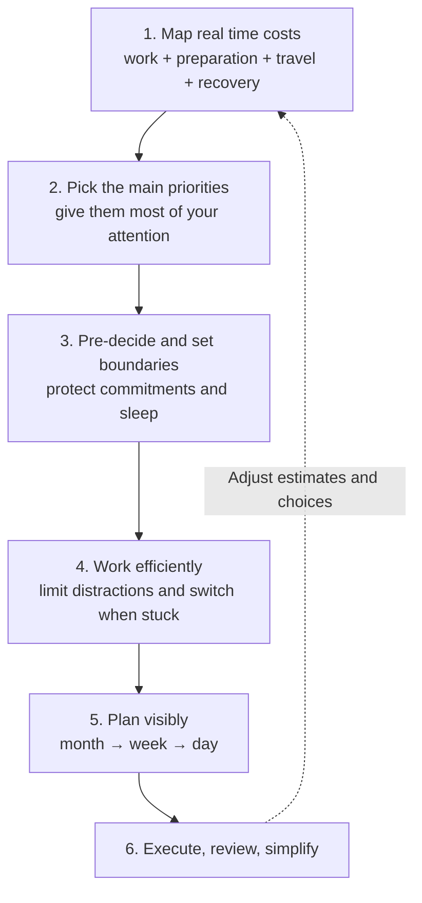
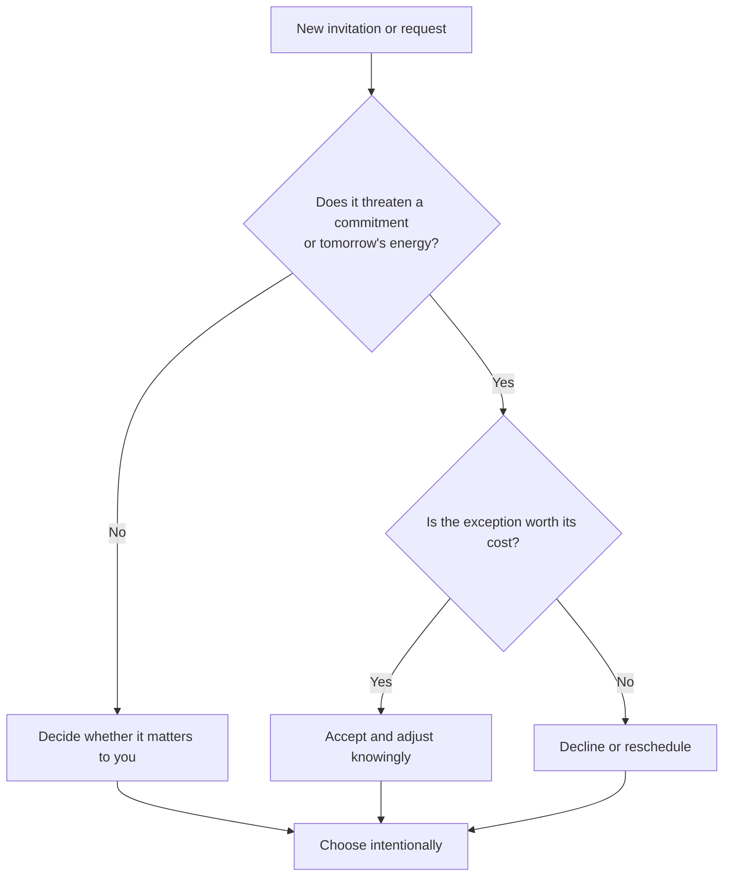

# Time management — prioritize, protect energy, execute

A practical approach to using time deliberately, adapted from Video 01. The speaker draws on balancing work since around age 12 with school, social life and personal time. She explicitly describes this as a **personal system**, not a universal productivity formula.

## Visual model

*Editorial synthesis of the speaker's tips, not an official method she named.*

**Core idea:** Optimize for meaningful work completed, not for a full calendar or an elaborate organization system.

## How we use it

### Nine techniques from the video

1. **Estimate the whole commitment.** An apparent 9–5 job may occupy 8–6 with commuting and getting ready; rest can extend the cost. In her 8:30–5 job she woke around 6 AM to fit in a walk, coffee and creative work. During café opening shifts she sometimes arrived early to prepare and journal. **Notice:** she chose early starts because mornings suited her—not because everyone should wake earlier. The larger principle is to **speed up low-value routines** so more time remains for what you actually value.
2. **Prioritize deliberately to avoid burnout.** She asks you to identify the most important goal rather than give every ambition equal weight. Her own small focus set has **two areas**: a creative career (YouTube, Instagram, Substack) and athletic fitness. She describes directing about **80% of her mental attention** to them and slotting other goals into the remaining 20%. This is not a literal, tracked division of hours. Her one-goal advice and two-area example point to **ranking priorities**, not forbidding all secondary goals.
3. **Use suitable in-between time for secondary goals.** She reads on trains and when she arrives before friends; she prepares a bag and outfit the night before to shorten mornings. Her lower-priority goals can go into these gaps without competing with primary goals. Assign small, portable tasks to suitable waiting periods so high-value hours stay free. But not every spare moment needs filling.
4. **Make decisions in advance, then defend them.** Pre-decide the next action instead of repeatedly wondering what to do, start the chosen task without prolonged deliberation, and say **no without guilt** if peer pressure threatens an important commitment. The speaker also warns that compromising one planned decision can affect later decisions. Consider this **knock-on cost**, not only the immediate request. The point is to reduce avoidable decisions—not to act immediately on every interruption.
5. **Evaluate the next-day cost.** Late parties or drinking can damage next-day energy even when there is time for them tonight. The speaker protects sleep: typically **in bed by 8:30 PM and asleep around 9:30–10 PM**. She usually says no when plans compromise self-commitments, yet reserves a spontaneous buffer. She calls herself a **Type B person forced to be Type A**: the structured schedule protects commitments, while flexibility leaves room for fun. This is her personal characterization, not a clinical personality category. Her illustrative **80/20** balance could be **60/40 or 50/50** for someone else. Prioritize relationships too: rescheduling an invitation is often better than dropping the friendship.
6. **Remove avoidable friction.** Her toolkit includes routines, habit stacking, practiced skills, **set-and-forget automation** for suitable repeatable tasks, attentiveness, quiet surroundings, putting the phone in another room, and experimenting with work-block durations. Her **hypothetical** example: a nominal two-hour work block **might contain only one hour of actual work** if the other hour disappears into scrolling reels. This is not a measured result. **Rest also matters:** working with an overworked brain is not always effective.
7. **Keep a backup task.** When mentally blocked on the primary task, switch intentionally to another useful item on the list—even **washing the dishes** if focused work is not possible. Return to the priority later; otherwise swapping tasks can become another form of avoidance.
8. **Set a minimum and a maximum.** A palatable **5-, 10-, or 15-minute minimum** helps start work you've been avoiding. A **maximum** protects other commitments by stopping one activity from spilling into the whole day. These solve different problems: starting resistance and lack of stopping boundaries.
9. **Externalize plans, then stop redesigning the system.** **At each month's end** she notes goals and major events; **every Sunday** she maps the coming week and its daily tasks. She uses **Google Calendar** for appointments/events/monthly outlook, **Notion** for weekly and daily details. Simple meals, organization and routines let her handle substantial commitments. In her **current season of creating and producing**, she needs execution more than tool maintenance. Repeatedly redesigning Notion consumes time that should go to creating and delivering. Her minimalist style is personal; simplicity need not look the same for everyone.

### Real decision test: Thursday invitation

The speaker offers a **deal or no deal** scenario: a friend invites you out at **8:30 PM Thursday**, you planned to sleep by **10 PM**, and you want to work the following morning. She would *usually decline* because she protects sleep, with **Friday** more likely to be an exception. She considers who invited her and how recently they met; she would **reschedule** rather than abandon the relationship. **Lesson:** weigh who/what matters, tomorrow's cost, and alternatives. There is no universally right choice.

### Decision map: should you accept the interruption?

*Our interpretation of her Thursday invitation example, not a prescribed algorithm.*

### Details worth noticing

- **Two different 80/20 rules:** she first describes attention across goals, then describes commitments versus spontaneity. They are illustrative personal ratios, not time-tracked measurements.
- **The early-start example is preference-dependent:** waking at 6 AM creates extra morning time only if sleep and recovery remain adequate.
- **Decisiveness is a trade-off:** saying no protects focus; selective yeses preserve important relationships and spontaneity.
- **Three different costs:** hours occupied by an obligation, focused work actually done, and next-day energy are not interchangeable. This is **our synthesis** of the shift, scrolling and sleep examples.
- **Capacity is not complexity:** her phrasing contrasts *simple systems* with the ability to carry many responsibilities. The aim is to **execute**, not become a better Notion decorator.
- **Selective optimization, not maximal busyness:** make lower-value tasks easier or faster to protect personally important activities; don't treat every free minute as a task slot.
- **Final self-check:** she asks whether you truly lack time or are avoiding figuring out a solution. Use this as a question for reflection, not as proof that everyone has enough time.

### Practical application: one-week experiment

- Choose **one verifiable outcome** for the week (for example, deliver a reviewed change, not merely "work on the project").
- Estimate its true cost, including setup, context switching and review.
- Reserve a focused block, with a small minimum to start and a realistic stop boundary.
- Prepare the first action the previous evening; protect sleep and leave buffer time.
- At week's end, compare what you **completed** with what you planned. Simplify one source of friction.

## Gotchas and lessons

- **The 80/20 split is not evidence of an optimal ratio:** she offers a personal heuristic, not measured results or a controlled comparison.
- **"Do it immediately" needs a filter:** act promptly on the chosen priority, but batch or defer unrelated interruptions to preserve deep work.
- **Efficiency is not constant activity:** idle time, rest and relationships can be valuable even without a measurable output.
- **Being busy is not the same as making progress:** evaluate shipped results and quality, not hours or checkboxes alone.
- **The closing challenge is motivational, not universal:** real constraints may limit available time. Scheduling cannot remove every obligation.
- **Attribution and evidence:** the anecdotes and techniques above come from the speaker's transcript. The diagrams, software-delivery example, one-week experiment, deep-work caveat and evaluation language are **our adaptations**, not direct speaker claims. The transcript provides no controlled productivity measurements. The transcript provides no controlled productivity measurements.

## Open questions

- What is the single most important outcome this week?
- Which recurring obligation is most underestimated in time or energy?
- Which decision or recurring preparation could be simplified without adding another tool?

## Links

- Source: [Video 01 — time management](https://www.youtube.com/watch?v=J4jfOXYU6f4). Third-pass checked against the complete **2,401-word user-provided transcript** on 2026-10-26. The transcript does not provide video timestamps; the full original text is **not** republished in this public repository.
- Related: [Agent delivery workflow](agent-delivery-workflow.md).
- Official docs: Not applicable; personal productivity practices.
