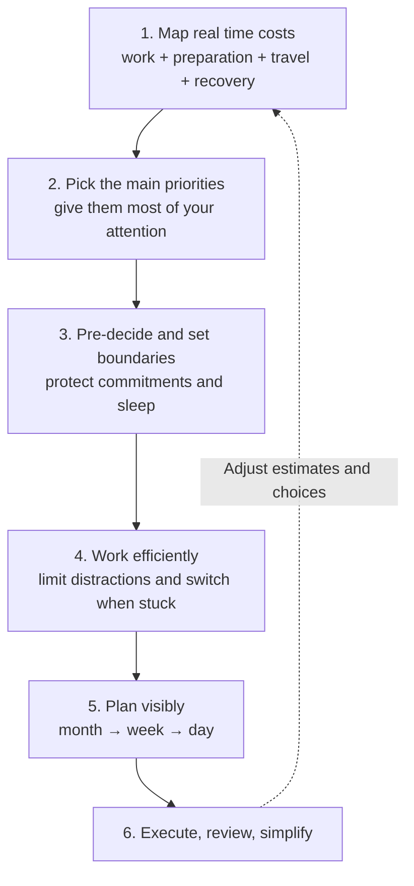

# Time management — prioritize, protect energy, execute

A practical approach to using time deliberately, adapted from Video 01. The speaker describes a **personal system**, not a universal productivity formula.

## Visual model

**Core idea:** Optimize for meaningful work completed, not for a full calendar or an elaborate organization system.

## How we use it

### Nine techniques from the video

1. **Estimate the whole commitment.** An apparent 9–5 job may occupy 8–6 with commuting and getting ready. Count recovery time when it materially affects the rest of the day.
2. **Prioritize deliberately.** Name the goal that matters most now. The speaker directs roughly 80% of her attention toward her creative work and fitness, leaving other goals in smaller slots.
3. **Use suitable in-between time.** Reading while commuting or waiting, and preparing bags or clothes the night before, can free up more valuable hours. Not every spare moment needs filling.
4. **Make decisions in advance.** Plan the next action and say no when a new commitment would undermine something important. Fewer repeated decisions means less friction.
5. **Evaluate the next-day cost.** Late plans can take tomorrow's energy through lost sleep or recovery. Keep flexibility for worthwhile exceptions, rather than enforcing a rigid rule.
6. **Remove avoidable friction.** Routines, habit stacking, practiced skills, automation, attention, and distraction-free environments can shorten work without sacrificing outcomes. Rest supports sustained effort.
7. **Keep a backup task.** If a task is blocked or concentration is poor, switch intentionally to another useful task; avoid turning that into indefinite avoidance of difficult work.
8. **Set a minimum and a maximum.** A 5-, 10-, or 15-minute minimum makes starting easier. A maximum prevents one activity from consuming every other commitment.
9. **Externalize plans, then stop redesigning the system.** The speaker plans monthly, weekly, and daily activities using Google Calendar for events/monthly outlook and Notion for daily/weekly details. Tools support execution; they are not the result.

### Practical application: one-week experiment

- Choose **one verifiable outcome** for the week (for example, deliver a reviewed change, not merely "work on the project").
- Estimate its true cost, including setup, context switching and review.
- Reserve a focused block, with a small minimum to start and a realistic stop boundary.
- Prepare the first action the previous evening; protect sleep and leave buffer time.
- At week's end, compare what you **completed** with what you planned. Simplify one source of friction.

## Gotchas and lessons

- **Two different 80/20 uses:** the speaker applies it both to *attention across goals* and *commitments versus spontaneity*. Both are personal heuristics, not proven ratios or mandatory time budgets.
- **"Do it immediately" needs a filter:** act promptly on the chosen priority, but batch or defer unrelated interruptions to preserve deep work.
- **Efficiency is not constant activity:** idle time, rest and relationships can be valuable even without a measurable output.
- **Being busy is not the same as making progress:** evaluate shipped results and quality, not hours or checkboxes alone.
- **The closing challenge is motivational, not universal:** real constraints may limit available time. Scheduling cannot remove every obligation.
- **Attribution:** techniques above reflect the speaker's transcript; the software-delivery example and one-week experiment are applications, not direct video quotations.

## Open questions

- What is the single most important outcome this week?
- Which recurring obligation is most underestimated in time or energy?
- Which decision or recurring preparation could be simplified without adding another tool?

## Links

- Source: [Video 01 — time management](https://www.youtube.com/watch?v=J4jfOXYU6f4). Synthesized from the user-provided transcript on 2026-10-26; the full transcript is **not** republished in this public repository.
- Related: [Agent delivery workflow](agent-delivery-workflow.md).
- Official docs: Not applicable; personal productivity practices.
